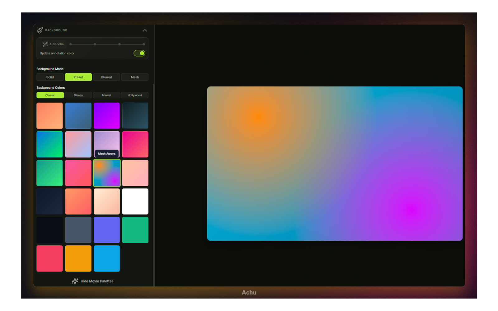
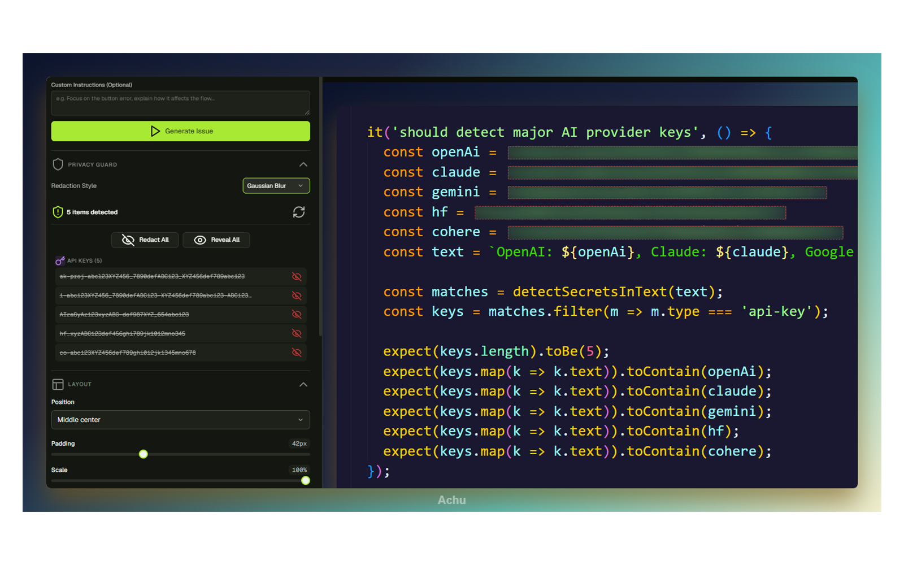
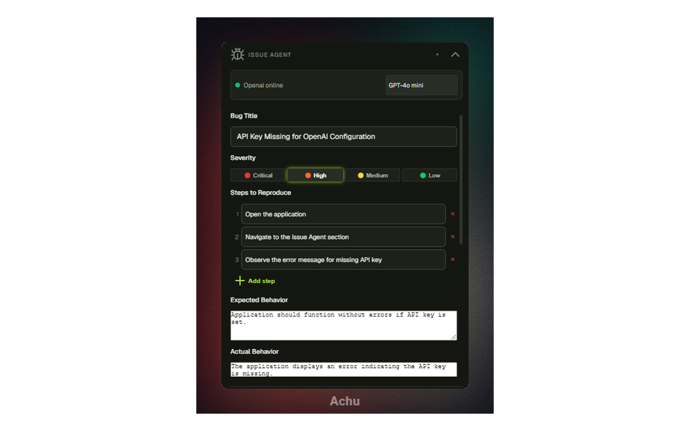
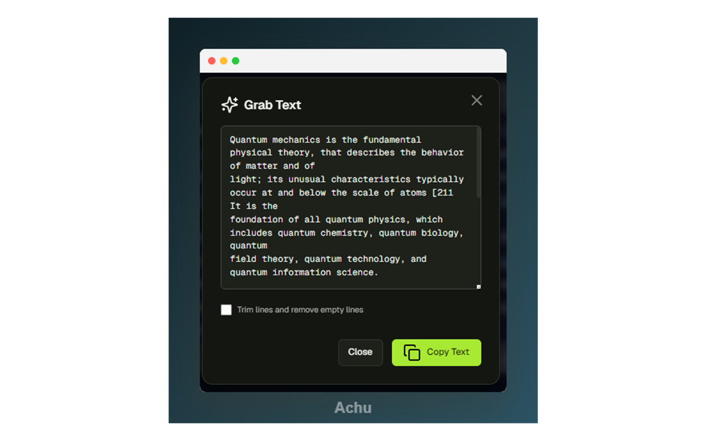
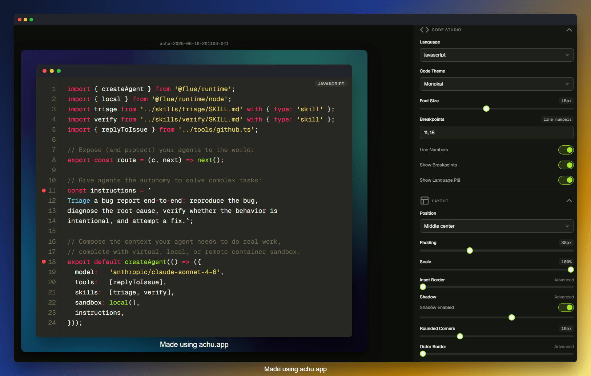
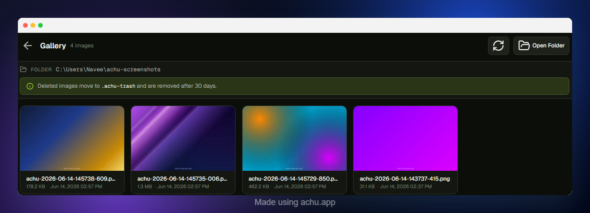

<p align="center">
  
</p>

<p align="center">
  
</p>

<p align="center">
  <strong>A lightweight, gorgeous desktop utility for Windows, macOS, and Linux that turns raw screenshots into polished visual assets.</strong>
</p>

<p align="center" style="font-size: 1.1em; color: #64748b;">
  achu (அச்சு) means `print` in Tamil. 🖨️
</p>

<p align="center">
  
  
  
  
  
  
  <br />
  
  
  
  
</p>

---

## 📸 Screenshots & Showcase

| 🎨 Canvas Beautification & Presets | 🛡️ Privacy Guard & Redaction |
| :---: | :---: |
|  |  |
| **🤖 AI Issue Agent Integration** | **🔍 OCR Text Extraction** |
|  |  |
| **🖥️ Code Studio** | **🖼️ Screenshot Gallery** |
|  |  |

---

## ✨ Features

### 🎨 Canvas & Framing Aesthetics
* **Beautification Layouts:** Frame screenshots with custom padding, background blur, rounded corners, adjustable shadows, scale, and custom aspect ratios.
* **Fluid Mesh Gradients:** Generate premium multi-point mesh gradients for background wrappers, along with linear/radial gradients and solid colors.
* **Browser Chrome Overlays:** Instantly add polished browser mockups (macOS-style or Windows-style window controls) around your screenshots.
* **Aspect Ratio Presets:** Quickly format your graphics for popular social platforms like Twitter/X, LinkedIn, and Product Hunt.

### 🛡️ Smart Privacy Guard
* **Auto-Scanning:** Scans screenshots locally using Tesseract WASM to automatically detect credentials, API keys, passwords, credit card numbers, email addresses, IP addresses, phone numbers, and physical locations.
* **Pixel-Perfect Redaction:** Toggle visibility for individual detected items or redact all with one click.
* **Gaussian Blur & Solid Masks:** Choose between soft Gaussian Blur or clean 100% Solid Color masks.
* **PNG Integrity:** Suggests exporting to PNG format for redacted captures to ensure deleted/masked pixel values are completely scrubbed and unrecoverable.

### 🤖 AI-Powered Issue Agent
* **Automated Bug Reporting:** Uses vision models to analyze your screenshot and generate full GitHub issue templates (titles, tags, reproduction steps, and system context).
* **Multi-Provider AI support:** 
  * **Ollama (Fully Offline):** Run models locally (e.g., `llava-phi3`) with no external data leaks.
  * **Google Gemini:** `gemini-2.5-flash`
  * **OpenAI:** `gpt-4o-mini`
  * **Anthropic Claude:** `claude-3-5-sonnet-latest`
* **Direct GitHub Integration:** Connect your repository and push the generated issue reports directly to GitHub.

### 🔍 OCR Canvas Text Grabber
* **Right-Click OCR:** Right-click anywhere on the canvas screenshot to extract text content instantly.
* **Grab Text Modal:** Edit, trim, format, and copy the extracted text to your clipboard.
* **100% Private:** Runs Tesseract OCR in-browser via WebAssembly, performing text extraction locally on your machine.

### 🖼️ Screenshot Gallery
* **Save to Gallery:** Export beautified screenshots directly to a local gallery folder with your chosen format (PNG, JPEG, or WebP) and compression settings.
* **Visual Grid Browser:** Browse saved captures with thumbnail previews, file sizes, and timestamps in a polished grid layout.
* **Quick Actions:** Re-open any image in the editor, copy it to the clipboard, reveal it in your file explorer, or delete it, all from the gallery card overlay.
* **Configurable Storage:** Choose a custom gallery folder in Settings, or use the default location under your user data directory.
* **Soft Delete & Auto-Purge:** Deleted images move to a `.achu-trash` folder and are automatically removed after 30 days.

### 🖥️ Code Studio
* **Paste & Beautify:** Paste JavaScript, Python, Java, or any code and instantly convert it into beautiful, shareable screenshots.
* **Line Numbers:** Toggle line numbers on or off to match your preferred style.
* **Color Themes:** Switch between multiple syntax-highlighting color themes to suit your brand or mood.
* **Language Pill:** Display a language badge on the screenshot so viewers immediately know which language they're looking at.
* **Debug Points:** Add or remove debug point markers to highlight specific lines for tutorials, bug reports, or reviews.

### 🖊️ Rich Vector Annotations
* **Drawing Tools:** Annotate screenshots using rectangles (filled/outline), ovals (filled/outline), straight lines, arrows, freehand pen, custom text fields, and emojis.
* **Full Object Control:** Move, resize, delete, and re-order drawn annotation layers.
* **Deep Edit History:** Full support for multi-step Undo (`Ctrl+Z`) and Redo (`Ctrl+Y`) operations.

### Stitch Screenshots
Select **Stitch Screenshots** in the editor toolbar and choose or drop 2–6 overlapping PNG, JPEG, or WebP screenshots in top-to-bottom order. The images must have the same pixel width (capture at the same window size). achu detects the overlap locally and shows a preview before importing a single combined image. If alignment is uncertain, adjust each overlap slider or enter an exact pixel value while checking the translucent seam preview; use the arrow buttons to change screenshot order. The combined image opens in the regular editor, where you can annotate, undo, and export it as usual.

achu keeps original resolution when the selection and combined image fit its safety budget. Large selections can be prepared as a **smaller copy**, with maximum dimensions shown before preparation and exact output dimensions shown after alignment. If only the combined output is too large, the preview offers **Import smaller copy** directly. Increasing overlap or choosing fewer screenshots can preserve more detail. Source files are never changed, and all processing stays on your device.

Metadata is checked before decoding. Memory planning includes file buffers, decoded sources, alignment samples, the output canvas and encoding headroom, using a conservative 512 MiB working budget. Hard ceilings still apply: 128 MiB of selected file data in total and 40 megapixels, 16,384px wide or 32,767px high per source. There is no aspect-ratio limit or separate 8 MB file limit. The combined copy fits within 20 megapixels and 16,000px high; unsafe or malformed inputs are rejected rather than decoded without a limit. The budget is an estimate, not a guarantee of available device memory.

Stitching works best with content-only captures: crop repeated browser chrome, sticky headers and footers from the source images first. It combines supplied screenshots; it does not scroll or capture a page automatically.

---

## ⌨️ Keyboard Shortcuts

| Shortcut | Description |
| :--- | :--- |
| **`Ctrl` + `V`** / **`Ctrl` + `Alt` + `V`** | Paste image from Clipboard |
| **`Ctrl` + `Z`** | Undo last action |
| **`Ctrl` + `Y`** | Redo last action |
| **`Ctrl` + `Shift` + `S`** | Copy beautified snap to clipboard |
| **`Delete`** / **`Backspace`** | Delete selected annotation object |
| **Arrow keys** / **`Shift` + Arrow keys** | Nudge the selected annotation by 1 / 10 canvas pixels while the canvas is focused; each held-key movement is one Undo step |
| **`Ctrl/Cmd` + `D`** | Duplicate the selected annotation with an offset while the canvas is focused, without replacing the annotation clipboard |
| **`V`** or **`1`** | Select / Move Tool |
| **`R`** / **`Shift` + `R`** / **`2`** / **`3`** | Rectangle Tool (Outline / Filled) |
| **`C`** / **`O`** / **`Shift` + `C`** / **`4`** / **`5`** | Circle / Oval Tool (Outline / Filled) |
| **`L`** / **`A`** / **`6`** / **`7`** | Line / Arrow Tool |
| **`Shift` while drawing** | Draw squares, perfect circles, or lines/arrows at 45-degree increments |
| **`T`** / **`P`** / **`8`** / **`9`** | Text / Freehand Pen Tool |
| **`E`** / **`0`** | Add Emoji Tool |

Right-click an annotation and choose **Reset Rotation** to straighten it without changing its position, size, or styling. Undo restores its previous rotation.

---

## 🚀 Getting Started

### Prerequisites
* **Node.js** 18 or higher
* **npm**

### Installation
1. Clone the repository:
   ```bash
   git clone https://github.com/QAInsights/achu.git
   cd achu
   ```

2. Install dependencies:
   ```bash
   npm install
   ```

3. Launch development mode with Hot Reload:
   ```bash
   npm run dev
   ```

---

## 🛠️ Build & Package

achu uses `electron-builder` to package lightweight native binaries for Windows, macOS, and Linux.

| Script | Action | Output / Description |
| :--- | :--- | :--- |
| `npm run build` | Compile code | Generates optimized production bundles in `app-bundle/` |
| `npm run test` | Run tests | Runs unit and rendering tests using `Vitest` |
| `npm run test:coverage` | Coverage | Generates a coverage report via `v8` |
| `npm run package` | Pack App | Builds production bundles and packages portable packages in `release/` |

* **Windows Target:** Standalone portable `.exe` executable (x64 / arm64).
* **Linux Target:** Standalone AppImage and `.deb` packages.
* **macOS Target:** Standalone `.dmg` disk image and `.zip` archives.

### macOS Gatekeeper (unsigned builds)

achu is **not yet code-signed or notarized** with an Apple Developer ID. After installing from a browser-downloaded DMG, macOS Gatekeeper (especially **Sequoia 15+**) may block the first launch with:

> **"achu" Not Opened** - *Apple could not verify "achu" is free of malware that may harm your Mac or compromise your privacy.*

Buttons are typically **Done** and **Move to Trash**. Do **not** choose **Move to Trash** if you want to keep the app.

> **Note:** Clearing quarantine with `xattr -cr` alone is often **not enough** on modern macOS. Right-click → **Open** is also unreliable on Sequoia. Prefer the steps below.

#### Option 1 - System Settings (recommended, no Terminal)

1. Try to open **achu** once so macOS records the block.
2. Click **Done** (not **Move to Trash**).
3. Open **System Settings → Privacy & Security**.
4. Scroll to the **Security** section.
5. Find a message like **"achu" was blocked to protect your Mac** and click **Open Anyway**.
6. Authenticate with Touch ID or your password.
7. Open **achu** again. When the warning reappears, click **Open**.

After the first successful open, subsequent launches should work normally.

#### Option 2 - Terminal

If the app is in `/Applications` (restore it from Trash first if needed):

```bash
# Strip quarantine attributes from the installed app
xattr -cr /Applications/achu.app

# Optional: apply an ad-hoc signature (can help when Gatekeeper reports the app as damaged)
codesign --force --deep --sign - /Applications/achu.app

open /Applications/achu.app
```

If Gatekeeper still blocks the app after this, complete **Option 1** (Open Anyway). On Sequoia, the System Settings path is often still required for unsigned downloads.

#### Option 3 - Build from source

A local build never receives the browser download quarantine flag:

```bash
git clone https://github.com/QAInsights/achu.git
cd achu
npm install
npm run dev
```

To package a local app bundle instead of using the release DMG:

```bash
npm run build
npx electron-builder --mac --publish never
```

#### Permanent fix (roadmap)

The lasting fix is **Developer ID signing + Apple notarization** in the release pipeline. Until that ships, Gatekeeper prompts on first launch of web-downloaded builds are expected.

---

## 🔒 Security & Privacy

* **Local OCR & Secrets Scanning:** Tesseract WASM scans and extracts your screenshot text strictly locally inside the Electron sandbox. No images or text are sent to third parties during OCR or Privacy Guard runs.
* **Secure Token Storage:** All external AI keys and GitHub API tokens are stored using Electron's native [safeStorage API](https://www.electronjs.org/docs/latest/api/safe-storage), which encrypts credentials on disk using operating-system-level cryptography (Keychain on macOS, DPAPI on Windows, and Secret Service/KWallet on Linux).
* **Anonymous Usage Stats:** Daily usage telemetry is on by default and can be turned off in Settings > General. It includes app and Electron versions, OS, CPU architecture, distribution channel, UI locale, a random install ID, a first-run flag, and aggregate feature counts. Images, text, paths, names, keys, and tokens are never sent.

Example telemetry payload:

```json
{
  "installId": "123e4567-e89b-12d3-a456-426614174000",
  "event": "daily",
  "appVersion": "2026.5.30",
  "electronVersion": "43.4.0",
  "os": "win32",
  "arch": "x64",
  "channel": "nsis",
  "locale": "en-US",
  "firstRun": false,
  "features": {
    "export_png": 3,
    "privacy_scan": 1
  }
}
```

See [PRIVACY.md](./PRIVACY.md) for the full details and opt-out options.

---

## ☕ Support & Community

If you find achu useful, consider supporting development or checking out QAInsights resources:

* **Sponsor & Donate:** [Buy Me a Coffee](https://buymeacoffee.com/qainsights)
* **License:** MIT License. See [LICENSE](./LICENSE) for details.
